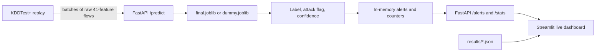

# System Design and Demo

## System overview

The demo classifies stored NSL-KDD flows through the same raw-feature interface used by the trained model. The replay client reads KDDTest+, sends small batches to FastAPI, and the service validates all 41 feature fields before inference. Each prediction includes its five-class label, attack flag, confidence, and measured inference latency. Attack predictions enter a bounded in-memory alert feed; aggregate class counts and alert rate are exposed separately. Streamlit consumes those endpoints and reads experiment JSON files for the model-metrics view.

## API behavior

- `GET /health` reports service status and whether the loaded artifact is the production model (`v1`) or demo stub (`dummy`).
- `POST /predict` accepts `{"flows": [{...}]}`; every flow must contain the 41 raw NSL-KDD fields. It returns per-flow predictions and batch inference latency in milliseconds.
- `GET /alerts?limit=50` returns the latest attack predictions, newest first. The in-memory store retains at most 5,000 alerts and resets when the process restarts.
- `GET /stats` returns per-label totals, total flows, and the fraction classified as attacks.

## Demo limits

The replay demonstrates near-live processing of a fixed benchmark file; it is not packet capture and does not inspect real network traffic. Before `models/final.joblib` exists, the service can use the deterministic dummy model to exercise the API and dashboard. The dummy output is for interface demonstration only and must not be reported as detection performance. The alert store is process-local and intended for a classroom demo, not durable deployment.

## Three-minute demo flow

1. Start the service and dashboard with `run.bat`; open the dashboard and show the health/model indicator.
2. In a second terminal, run `python -m app.replay --limit 300 --rate 4`. Explain that this replays benchmark rows rather than capturing traffic.
3. Show the live alert feed, class counts, alert rate, and confidence. Point out that every alert carries the predicted attack family.
4. Open the model-metrics page and explain that it reads the shared experiment JSON outputs.
5. Show `/health`, `/alerts?limit=5`, and `/stats` in the browser or API docs at `/docs`.
6. Close by stating which model artifact is loaded. If the dummy is active, explicitly label its predictions as demonstration-only.

### Backup if the API or replay fails

Open the dashboard after starting its Streamlit process, show the model-metrics page from saved results, and use FastAPI's `/docs` page to demonstrate the documented request/response shape. Explain that the dashboard's live feed requires the API to be running.
